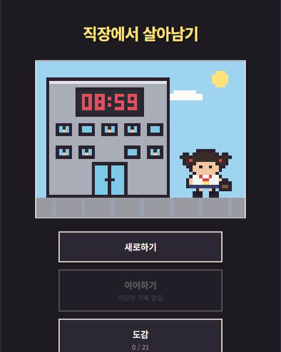

# minmi0123.github.io

`minlabnote.com` 의 허브 페이지. 토이 프로젝트들의 입구 역할을 한다.

```
AI: 이 repo 는 Public 이다. 실명·직장명·개인 이메일 금지 규칙은 2026-10-31 해제됐다.
    토큰·인증 파일 같은 보안 정보만 넣지 않는다. 상세는 ../dev-guide/trouble.md.
```

## 구조

빌드 과정이 없고 의존성도 없다. GitHub Pages 가 `main` 브랜치 루트를 그대로 서빙한다.

```
index.html              허브 (스타일 인라인)
thumb/                  허브 카드 썸네일 · 배너 그림 (아래 "그림 넣기" 절)
privacy/index.html      개인정보처리방침 (스타일 인라인)
log/index.html          개발 일지 목록
log/log.css             개발 일지 공통 스타일 (목록 + 모든 글)
log/_template/          글 템플릿. 배포되지 않는다 (아래 "개발 일지" 절)
log/<글-주소>/index.html  개별 글
ads.txt · CNAME
```

## 주소가 이렇게 잡히는 이유

계정 사이트(`{username}.github.io`) repo 에 커스텀 도메인을 붙이면
**나머지 repo 가 자동으로 하위 경로가 된다.**

```
minmi0123.github.io       → minlabnote.com/
minmi0123/lotto-lab       → minlabnote.com/lotto-lab/
minmi0123/lifecaluclate   → minlabnote.com/lifecaluclate/
```

그래서 페이지 안의 링크는 `/lotto-lab/` 처럼 **루트 기준 절대 경로**로 쓴다.
`minmi0123.github.io` 에서도, `minlabnote.com` 에서도 똑같이 동작한다.
전체 URL 을 박아 넣으면 도메인을 바꿀 때 전부 고쳐야 한다.

## 담고 있는 것

허브는 위에서부터 다음 순서다 (2026-10-12 개편. 틀은 `../../reference/awesome-design-md/design-md/airbnb/DESIGN.md` 를 따랐다).

| 구역 | 내용 |
|---|---|
| 상단 바 | 로고 글자 + 이동 링크 (게임 · 학습 · 웹 · 일지 `/log/`) |
| 배너 | 대표작 1개 + 알약 버튼. 지금은 직장에서 살아남기 |
| 게임 줄 · 학습 줄 · 웹 줄 | 4:5 세로 썸네일 카드. 그림 아래 제목 · 한 줄 설명 · 태그 |

학습 줄은 개념을 배우는 학습게임 (2026-10-31 신설, 계속 늘릴 예정). 첫 카드는 쿠버네티스 주식회사 (`/k8s-sim/`).
장면 수는 늘어날 예정이라 태그에 개수를 적지 않는다.

앱을 추가할 때는 줄 안에 `.card` 하나를 넣는다. 카드의 `--c` 는 그림이 없을 때 보이는 바탕색이다.

2026-10-31 에 "하나씩 소개" (앱별 문단) 를 기획자 결정으로 삭제했고, 첫 화면 소개 문구와
"이곳에 대하여" 는 `/log/about/` 글로 옮겼다. 그래서 허브에는 읽을 글이 거의 없다.
애드센스 심사에서 링크만 있는 페이지는 "가치 없는 콘텐츠" 로 반려되는 대표 유형이고 2026-10-10 에
실제로 반려됐으므로 (`../dev-guide/수익화.md` 3-4 절), 읽을 글은 `/log/` 에 쌓는다.

넣지 않기로 한 것: 인기 순위 · 플레이 수 (셀 데이터가 없다. 지어내지 않는다) · 검색 · 로그인 · 하단 탭바.

## 그림 넣기

2026-10-12 에 배포된 앱 화면을 Playwright 로 캡처해 넣었다. 썸네일 6장은 480 x 600 뷰포트의 첫 화면
(`boss` 만 게임 안 화면), 배너는 직장에서 살아남기 타이틀 도트 그림을 720 x 540 으로 키워 찍은 것이다.
이모몬은 배포 전이라 `../emojimon2/app` 을 로컬(`npm run dev`)로 띄워 로그인 화면을 찍었다
(게임 화면은 구글 로그인 뒤라 자동 캡처가 안 된다). 앱 화면이 바뀌면 같은 방법으로 다시 찍는다.

앱을 추가할 때:

```
1. thumb/ 폴더에 그림을 넣는다
   썸네일은 4:5 세로 (예: 480 x 600), 배너는 가로가 긴 그림. 파일 이름은 영문 소문자와 하이픈만
2. index.html 에서 해당 카드의 .thumb 안에 한 줄을 넣는다
   <div class="thumb" style="--c:#ffe3e8"><b>직장에서 살아남기</b></div>
   그림이 제목 글자를 덮는다. <b> 는 지우지 않는다 (그림이 안 뜰 때 보인다)
   "작업 중" 같은 .badge 는 그림 위에 그대로 보인다
3. 배너 그림은 index.html 의 .banner 안 .banner-art 의  다. 대표작을 바꾸면 thumb/banner.jpg 를 교체한다
```

비율이 달라도 `object-fit:cover` 로 잘려서 채워진다. 중요한 부분이 가운데 오게 자른다.

## 개발 일지 (`/log/`)

애드센스 심사가 보는 "읽을 글" 이 쌓이는 곳이다. 왜 여기에 쓰는지는 `../dev-guide/todo.md` 애드센스 절.

글 하나 올리는 순서:

```
1. log/_template/ 을 통째로 복사해 log/<글-주소>/ 로 이름을 바꾼다
   글-주소 는 영문 소문자와 하이픈만 (예: salaryman-ending-design)
2. 복사한 index.html 에서 [대괄호] 자리를 채운다
   제목 3곳 · 요약 2곳 · 글-주소 2곳 · 프로젝트 이름 · 날짜 · 관련 앱 상자
3. "본문 시작" ~ "본문 끝" 사이를 글로 바꾼다. 그림은 같은 폴더에 넣는다
4. 맨 위 템플릿 안내 주석을 지운다
5. log/index.html 의 <ul class="posts"> 맨 위에 <li> 를 추가한다 (최신이 위)
```

첫 글은 `log/about/` (이곳에 대하여, 2026-10-31). 허브 상단 바 "일지" 가 `/log/` 로 간다.

- 글 안의 `[` 가 남아 있지 않은지 커밋 전에 검색한다: `git grep -n "\[" -- log ":!log/_template"`
- `_template` 이 배포되지 않는 것은 GitHub Pages 의 Jekyll 이 `_` 로 시작하는 폴더를 빼기 때문이다.
  **repo 루트에 `.nojekyll` 을 만들면 템플릿이 그대로 공개된다.** 만들지 않는다
- 스타일은 `log/log.css` 하나다. 글마다 `<style>` 을 넣지 않는다. 색은 아래 "색" 절을 따른다
- 티스토리에 같은 글을 올려도 된다 (2026-10-31 구글 공식 문서 확인). 중복 콘텐츠는 스팸 정책 위반이 아니고
  벌점도 없다. 애드센스 "복제 콘텐츠" 정책은 남의 사이트 글을 가져다 쓰는 경우다. 다만 비슷한 페이지 여럿 중
  구글이 하나만 대표로 검색에 보여주므로, 티스토리 쪽이 뽑히면 이 글의 검색 유입이 줄 수 있다.
  내 글을 내 사이트 두 곳에 올리는 경우는 공식 문서에 명시가 없다. 그래서 다음을 지킨다:
  1. log 에 먼저 올리고 티스토리는 며칠 뒤에 올린다
  2. log 가 완성판 (손그림 · 게임 링크 전부), 티스토리는 문단을 줄이거나 바꾼 판
  3. 티스토리 글 끝에 minlabnote.com 원문 링크를 단다
  근거: developers.google.com/search/docs/crawling-indexing/canonicalization ,
  support.google.com/publisherpolicies/answer/11190248

## 올리지 않은 프로젝트

| repo | 이유 |
|---|---|
| `boss` | 작업 중. 완성 후 추가 |
| `WorkvivalKit` | 올리지 않기로 함 (2026-09-29 결정) |
| `starboard` | Private. 공개 점검 전 |

## 색

다크 모드는 없다 (2026-10-12 에 뺐다). 밝은 화면 하나만 쓴다.

색은 `:root` 의 CSS 변수로 정의하고, 허브 `index.html` · `privacy/index.html` · `log/log.css`
세 곳이 같은 값을 쓴다. 바꿀 때 세 곳을 함께 고친다.

- `--accent` (#ff385c): 버튼 · 배지 · 로고처럼 크거나 굵은 것에만 쓴다. 흰 바탕 대비가 약 3.5:1 이라 작은 글씨에는 모자라다
- `--accent-deep` (#e00b41): 링크처럼 작은 글씨에 쓰는 강조색
- 강조색은 아껴 쓴다. 화면 대부분은 흰색과 먹색이다
